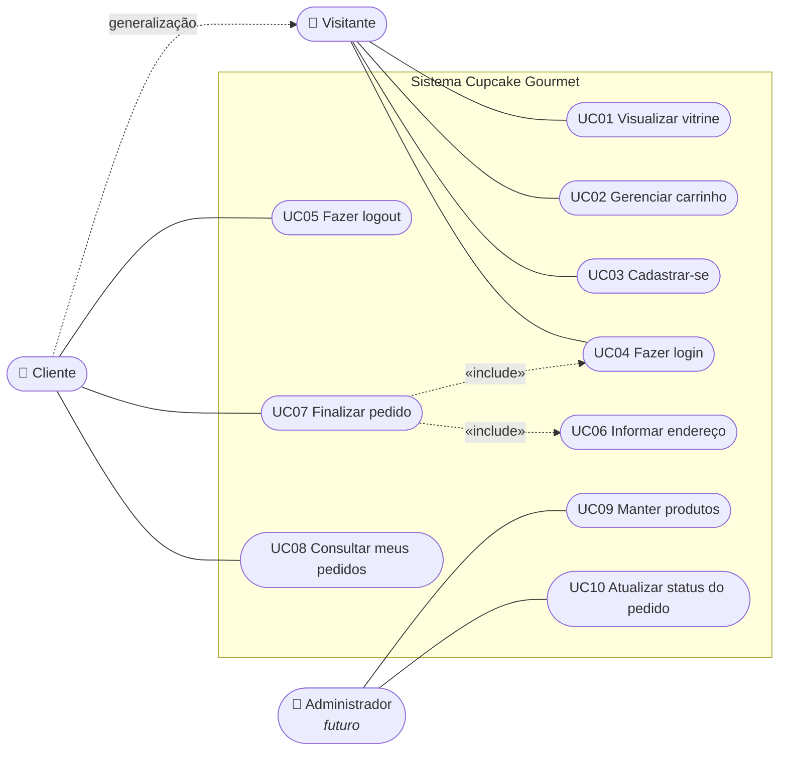
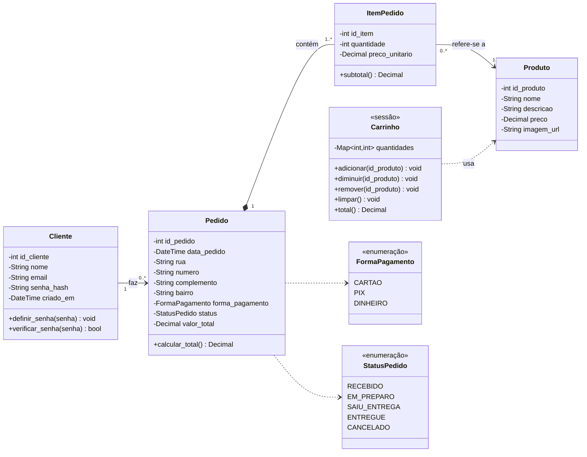
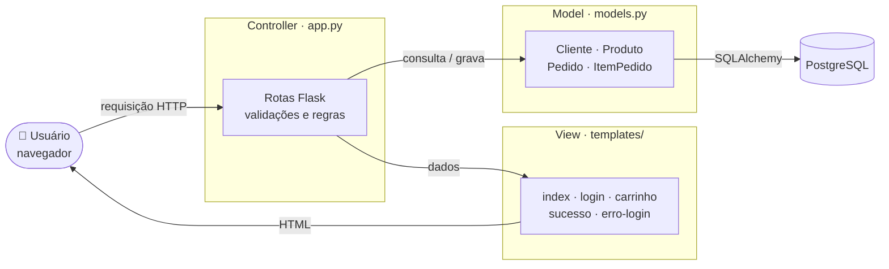
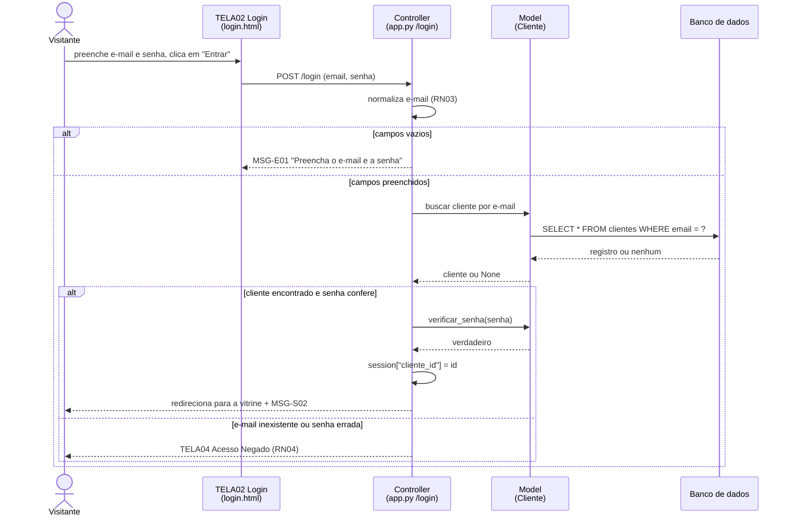
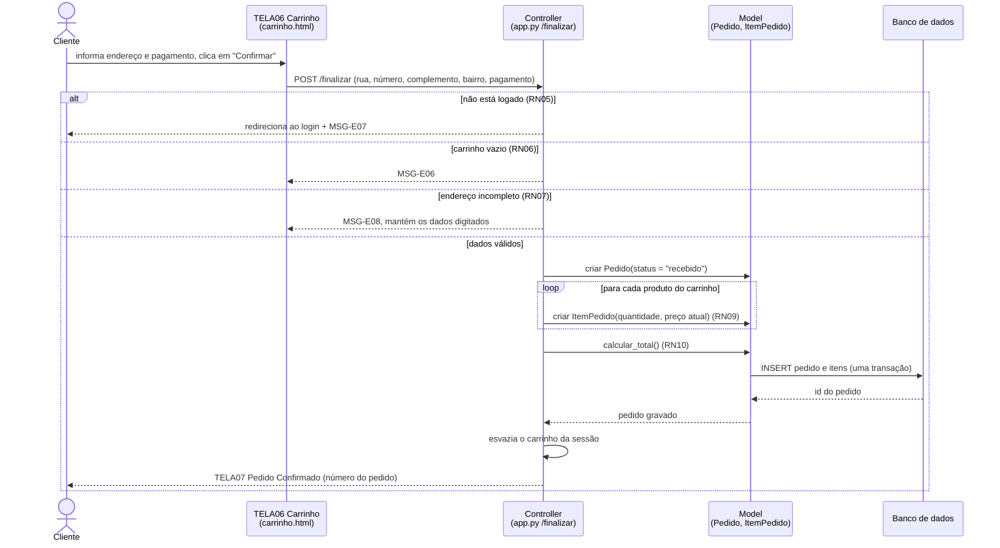
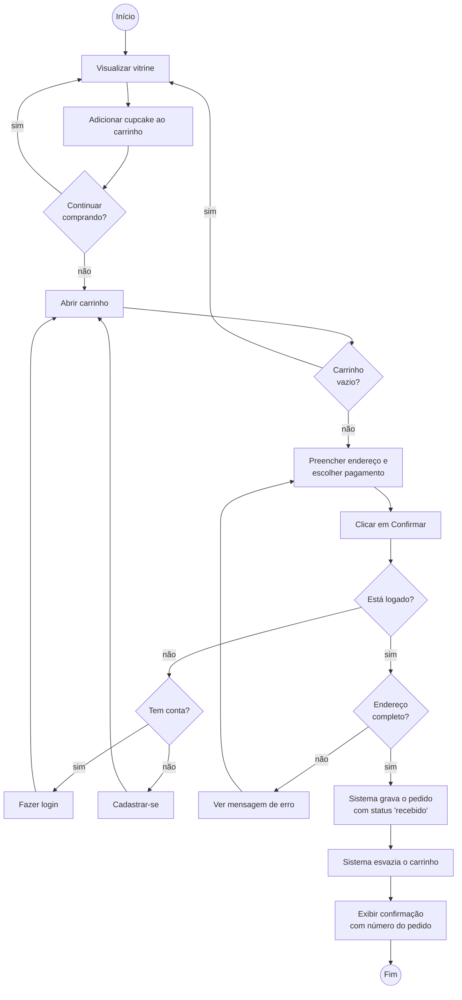
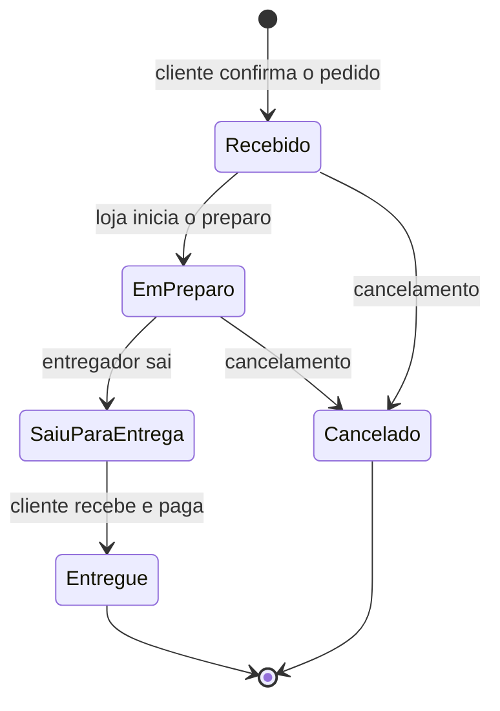

# 2. Modelagem UML

Os diagramas foram escritos em [Mermaid](https://mermaid.js.org/), que o GitHub desenha automaticamente. Assim, a modelagem fica versionada junto com o código e é fácil de manter atualizada.

## 2.1 Diagrama de casos de uso

O **Cliente** é um Visitante que se identificou, por isso herda todos os casos de uso do Visitante. Finalizar o pedido **inclui** obrigatoriamente o login e o endereço de entrega.

## 2.2 Casos de uso expandidos

### UC03 – Cadastrar-se

| | |
|---|---|
| **Identificador** | UC03 |
| **Ator** | Visitante |
| **Descrição** | O visitante cria uma conta para poder fazer pedidos. |
| **Pré-condições** | O visitante não está logado. |
| **Pós-condições** | O cliente está gravado no banco e logado no sistema. |
| **Histórias** | US05, US08 |

**Fluxo principal**
1. O visitante clica no ícone 👤 da vitrine.
2. O sistema exibe a TELA02 – Login/Cadastro.
3. O visitante escolhe a aba "Quero me cadastrar".
4. O visitante informa nome, e-mail e senha e clica em "Cadastrar".
5. O sistema valida os dados conforme RN01, RN02 e RN03. *(Fluxos alternativos A1 e A2)*
6. O sistema grava o cliente com a senha criptografada.
7. O sistema inicia a sessão do cliente.
8. O sistema exibe a TELA01 – Vitrine com a mensagem MSG-S01 e "Olá, [nome]" no topo.

**Fluxo alternativo A1 – Dados inválidos** (passo 5)
- A1.1 O sistema detecta nome vazio, e-mail em formato inválido ou senha com menos de 6 caracteres.
- A1.2 O sistema mostra as mensagens MSG-E02, MSG-E03 ou MSG-E04 na própria tela, mantendo o nome e o e-mail digitados.
- A1.3 O caso de uso volta ao passo 4.

**Fluxo alternativo A2 – E-mail já cadastrado** (passo 5)
- A2.1 O sistema encontra o e-mail no banco.
- A2.2 O sistema mostra a mensagem MSG-E05.
- A2.3 O caso de uso volta ao passo 4, ou o visitante escolhe a aba de login (UC04).

### UC04 – Fazer login

| | |
|---|---|
| **Identificador** | UC04 |
| **Ator** | Visitante |
| **Descrição** | O visitante se identifica com e-mail e senha. |
| **Pré-condições** | O visitante possui cadastro. |
| **Pós-condições** | A sessão do cliente está ativa. |
| **Histórias** | US06, US08 |

**Fluxo principal**
1. O visitante acessa a TELA02 – Login/Cadastro, aba "Já sou cliente".
2. O visitante informa e-mail e senha e clica em "Entrar".
3. O sistema procura o cliente pelo e-mail (RN03) e compara a senha com o *hash* guardado. *(Fluxos alternativos A1 e A2)*
4. O sistema inicia a sessão do cliente.
5. O sistema exibe a TELA01 – Vitrine com a mensagem MSG-S02.

**Fluxo alternativo A1 – Campos vazios** (passo 3)
- A1.1 O sistema mostra a mensagem MSG-E01 e o caso de uso volta ao passo 2.

**Fluxo alternativo A2 – Credenciais inválidas** (passo 3)
- A2.1 O e-mail não existe ou a senha não confere.
- A2.2 O sistema exibe a TELA04 – Acesso Negado, sem dizer qual dos dois estava errado (RN04).
- A2.3 O visitante clica em "Tentar Novamente" e o caso de uso volta ao passo 1.

### UC07 – Finalizar pedido

| | |
|---|---|
| **Identificador** | UC07 |
| **Ator** | Cliente |
| **Descrição** | O cliente confirma a compra dos itens do carrinho, com entrega e pagamento na entrega. |
| **Pré-condições** | Há pelo menos um item no carrinho (RN06). |
| **Pós-condições** | O pedido e seus itens estão gravados com status "recebido", e o carrinho está vazio. |
| **Histórias** | US09, US10, US11, US12, US15 |

**Fluxo principal**
1. O cliente acessa a TELA06 – Carrinho/Finalizar Pedido.
2. O sistema exibe os itens, o subtotal de cada um e o total (RN10).
3. O cliente informa rua, número, complemento e bairro (UC06).
4. O cliente escolhe a forma de pagamento: cartão, PIX ou dinheiro (RN08).
5. O cliente clica em "Confirmar".
6. O sistema verifica se o cliente está logado (RN05). *(Fluxo alternativo A1)*
7. O sistema valida o endereço (RN07) e o carrinho (RN06). *(Fluxos alternativos A2 e A3)*
8. O sistema grava o pedido, com o status "recebido" (RN11), e um item para cada produto, com o preço atual (RN09).
9. O sistema esvazia o carrinho.
10. O sistema exibe a TELA07 – Pedido Confirmado, com o número do pedido.

**Fluxo alternativo A1 – Cliente não logado** (passo 6)
- A1.1 O sistema guarda que o destino após o login é o carrinho.
- A1.2 O sistema exibe a TELA02 com a mensagem MSG-E07.
- A1.3 O visitante executa UC04 (ou UC03) e o sistema o devolve ao passo 1, com o carrinho preservado.

**Fluxo alternativo A2 – Endereço incompleto** (passo 7)
- A2.1 O sistema mostra a mensagem MSG-E08 indicando o campo, mantendo os dados digitados.
- A2.2 O caso de uso volta ao passo 3.

**Fluxo alternativo A3 – Carrinho vazio** (passo 7)
- A3.1 O sistema mostra a mensagem MSG-E06.
- A3.2 O caso de uso termina.

## 2.3 Diagrama de classes (persistência e domínio)

Notas sobre os relacionamentos:
- **Composição** entre Pedido e ItemPedido: um item não existe sem o seu pedido. Por isso, no banco, excluir o pedido exclui os itens (`ON DELETE CASCADE`).
- **Associação** entre ItemPedido e Produto: o produto existe de forma independente e pode estar em vários pedidos.
- **Carrinho** não é persistido no banco: ele vive na sessão do navegador até o pedido ser confirmado. Por isso aparece com o estereótipo «sessão».
- Todas as classes de persistência (`Cliente`, `Produto`, `Pedido` e `ItemPedido`) estão implementadas em `models.py`. O carrinho guarda `{id_produto: quantidade}` na sessão.

## 2.4 Arquitetura em camadas (MVC)

## 2.5 Diagramas de sequência

### Fazer login (UC04)

### Finalizar pedido (UC07)

## 2.6 Diagrama de atividades – processo de compra

## 2.7 Diagrama de estados – pedido

