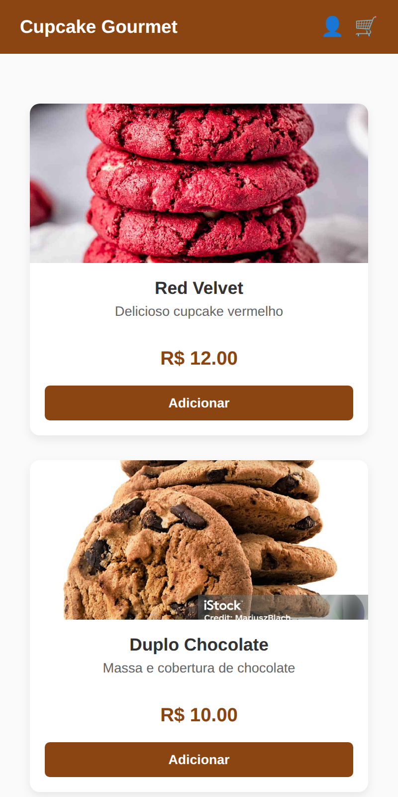
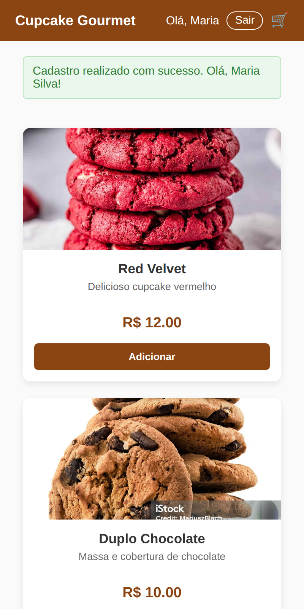
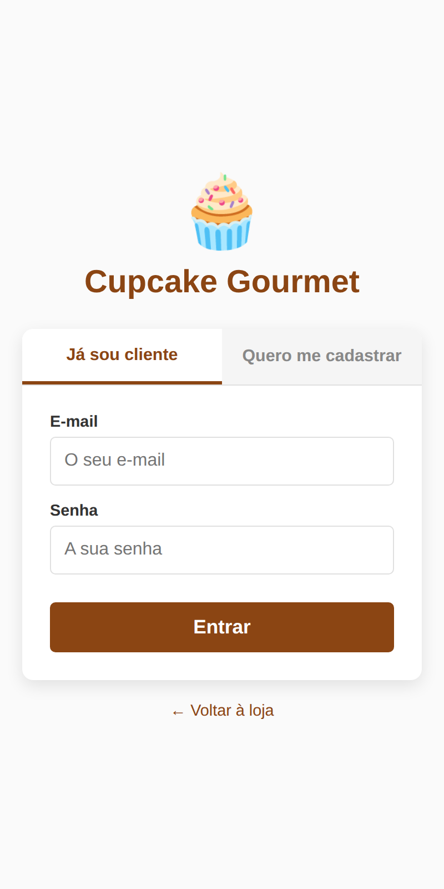
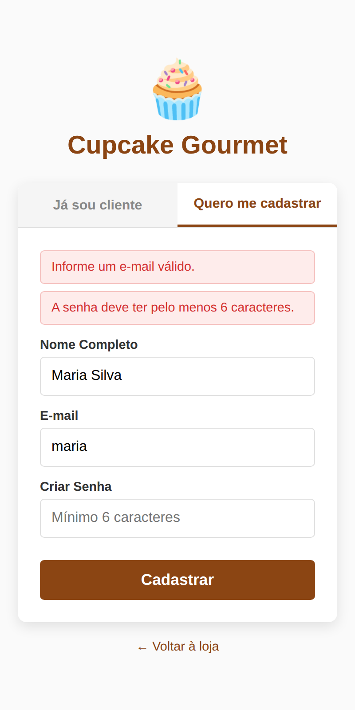
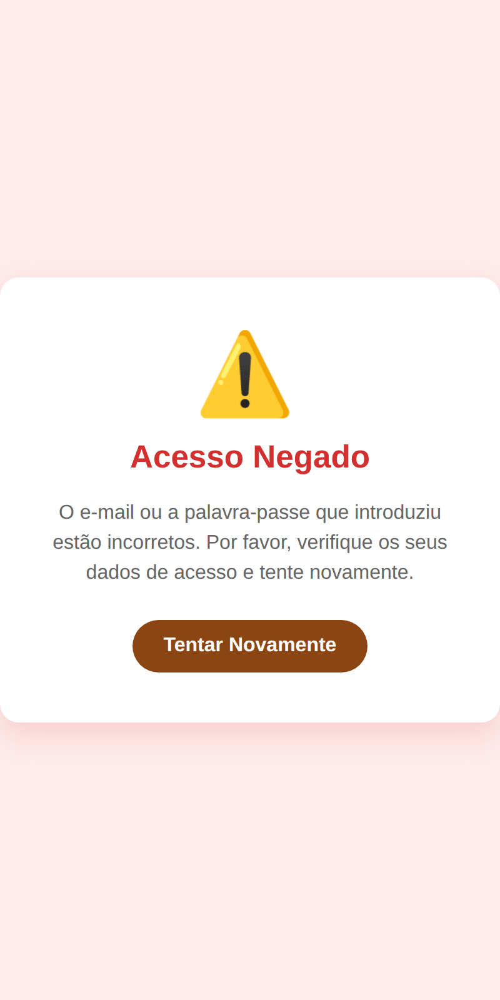
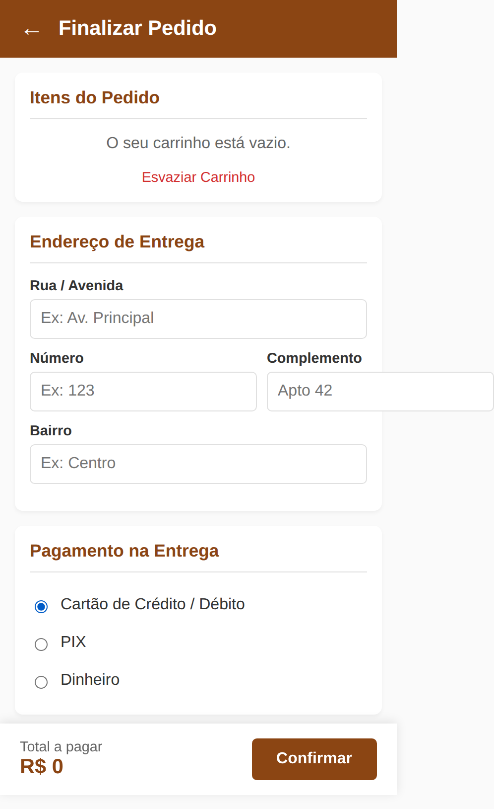
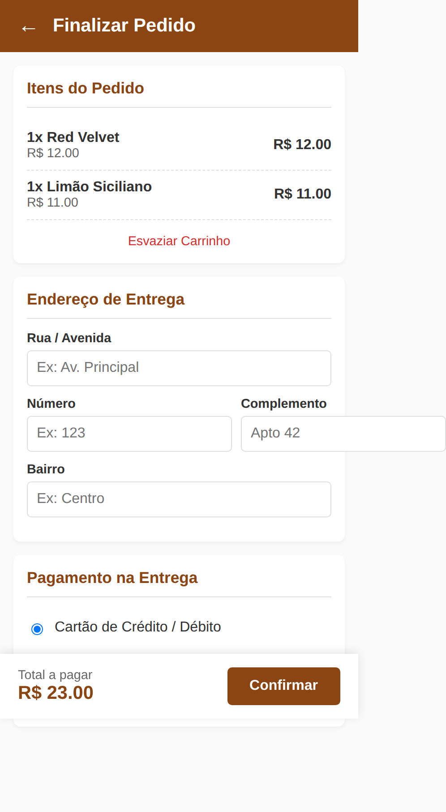
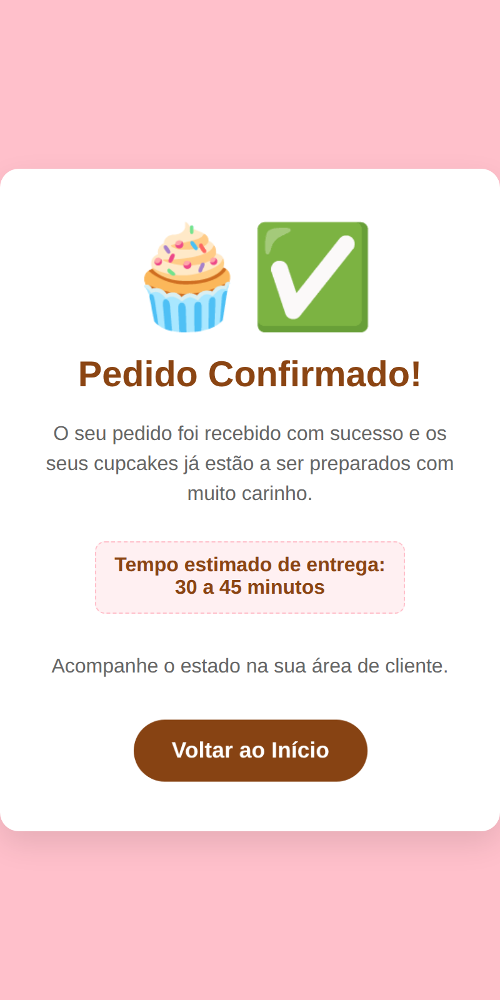
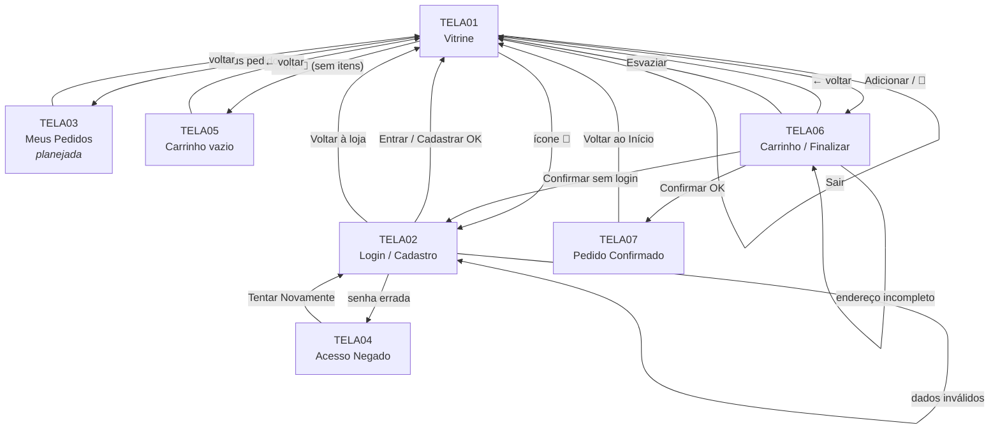
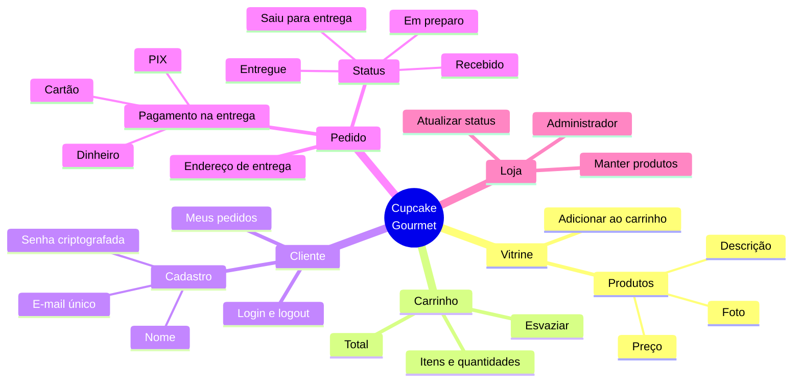

# 3. Interface Humano-Computador (IHC)

## 3.1 Princípios adotados

| Princípio | Como foi aplicado |
|---|---|
| **Clareza** | Uma ação principal por tela, com botões grandes ("Adicionar", "Cadastrar", "Confirmar"). |
| **Consistência** | Mesma cor (marrom chocolate `#8B4513`), cabeçalho, fonte e estilo de botões em todas as telas. |
| **Simplicidade** | Login e cadastro na mesma tela, em abas; checkout em uma única página. |
| **Controle do usuário** | Ícone de voltar no carrinho, link "Voltar à loja", botão "Esvaziar Carrinho" e "Sair". |
| **Feedback** | Mensagens verdes de sucesso e vermelhas de erro, logo acima do formulário. |
| **Recuperação de erros** | Quando há erro, os dados digitados continuam no formulário (exceto a senha). |
| **Responsividade** | Layout em grade que vira uma coluna no celular; barra de total fixa no rodapé do checkout. |

## 3.2 Telas do sistema

Capturas da aplicação real, em tamanho de celular.

| ID | Tela | Arquivo | Situação |
|---|---|---|---|
| TELA01 | Vitrine | `index.html` | ✅ |
| TELA02 | Login / Cadastro | `login.html` | ✅ |
| TELA03 | Meus Pedidos | — | 🔜 Planejada |
| TELA04 | Acesso Negado | `erro-login.html` | ✅ |
| TELA05 | Carrinho vazio | `carrinho.html` | ✅ |
| TELA06 | Carrinho / Finalizar Pedido | `carrinho.html` | ✅ (envio do pedido planejado) |
| TELA07 | Pedido Confirmado | `sucesso.html` | ✅ (número do pedido planejado) |

| TELA01 – Vitrine | TELA01 – Cliente logado | TELA02 – Login |
|---|---|---|
|  |  |  |

| TELA02 – Erros no cadastro | TELA04 – Acesso Negado | TELA05 – Carrinho vazio |
|---|---|---|
|  |  |  |

| TELA06 – Carrinho / Finalizar | TELA07 – Pedido Confirmado |
|---|---|
|  |  |

## 3.3 Campos das telas

**TELA02 – Login / Cadastro**

| Aba | Campo | Tipo | Obrigatório | Validação |
|---|---|---|---|---|
| Já sou cliente | E-mail | e-mail | Sim | formato de e-mail |
| Já sou cliente | Senha | senha | Sim | — |
| Quero me cadastrar | Nome Completo | texto | Sim | não vazio |
| Quero me cadastrar | E-mail | e-mail | Sim | formato de e-mail; único (RN01) |
| Quero me cadastrar | Criar Senha | senha | Sim | mínimo 6 caracteres (RN02) |

**TELA06 – Carrinho / Finalizar Pedido**

| Seção | Campo | Tipo | Obrigatório | Validação |
|---|---|---|---|---|
| Endereço | Rua / Avenida | texto | Sim | até 150 caracteres (RN07) |
| Endereço | Número | texto | Sim | até 10 caracteres; aceita "S/N" (RN07) |
| Endereço | Complemento | texto | Não | até 60 caracteres |
| Endereço | Bairro | texto | Sim | até 80 caracteres (RN07) |
| Pagamento | Forma de pagamento | opção | Sim | cartão, PIX ou dinheiro (RN08) |

## 3.4 Catálogo de mensagens

| ID | Tipo | Quando aparece | Mensagem | Tela | Situação |
|---|---|---|---|---|---|
| MSG-E01 | Erro | Login com campos vazios | "Preencha o e-mail e a senha." | TELA02 | ✅ |
| MSG-E02 | Erro | Cadastro sem nome | "Informe o seu nome." | TELA02 | ✅ |
| MSG-E03 | Erro | E-mail em formato inválido | "Informe um e-mail válido." | TELA02 | ✅ |
| MSG-E04 | Erro | Senha curta | "A senha deve ter pelo menos 6 caracteres." | TELA02 | ✅ |
| MSG-E05 | Erro | E-mail já cadastrado | "Este e-mail já está cadastrado. Faça login." | TELA02 | ✅ |
| MSG-E06 | Aviso | Carrinho sem itens | "O seu carrinho está vazio." | TELA05 | ✅ |
| MSG-E07 | Aviso | Confirmar pedido sem estar logado | "Faça login para finalizar o seu pedido." | TELA02 | 🔜 |
| MSG-E08 | Erro | Endereço incompleto | "Preencha rua, número e bairro para a entrega." | TELA06 | 🔜 |
| MSG-E09 | Erro | E-mail ou senha incorretos | Tela "Acesso Negado" com "Tentar Novamente" | TELA04 | ✅ |
| MSG-S01 | Sucesso | Cadastro concluído | "Cadastro realizado com sucesso. Olá, [nome]!" | TELA01 | ✅ |
| MSG-S02 | Sucesso | Login concluído | "Bem-vindo(a) de volta, [nome]!" | TELA01 | ✅ |
| MSG-S03 | Sucesso | Logout | "Você saiu da sua conta." | TELA01 | ✅ |
| MSG-S04 | Sucesso | Pedido gravado | Tela "Pedido Confirmado" com o número do pedido | TELA07 | 🟡 |

## 3.5 Mapa navegacional

A **Vitrine** é a tela central: todas as outras levam de volta a ela.

## 3.6 Mapa conceitual

## 3.7 Revisão da interface (melhoria contínua)

Ao revisar as telas reais, foram encontrados os pontos abaixo, que entram no backlog:

| # | Problema encontrado | Tela | Melhoria proposta | Prioridade |
|---|---|---|---|---|
| 1 | No celular, o campo "Complemento" ultrapassa a borda da tela | TELA06 | Adicionar `min-width: 0` aos campos da linha número/complemento | A |
| 2 | Itens iguais aparecem repetidos ("1x Red Velvet" duas vezes) | TELA06 | Agrupar por produto, mostrar a quantidade e botões + / − (US14) | B |
| 3 | Os preços aparecem como "R$ 12.00" | TELA01, TELA06 | Usar o padrão brasileiro "R$ 12,00" | B |
| 4 | Textos em português de Portugal ("palavra-passe", "introduziu", "estão a ser preparados") | TELA04, TELA07 | Padronizar em português do Brasil | B |
| 5 | Fotos mostram cookies em vez de cupcakes, e uma tem marca d'água de banco de imagens | TELA01 | Usar fotos de cupcakes com licença livre (ex.: Unsplash, Pexels) | A |
| 6 | A tela de sucesso cita uma "área de cliente" que ainda não existe | TELA07 | Criar a TELA03 – Meus Pedidos (US13) e o link para ela | B |
| 7 | O pedido confirmado não mostra número nem resumo | TELA07 | Exibir número, itens, total e endereço (US12) | A |
