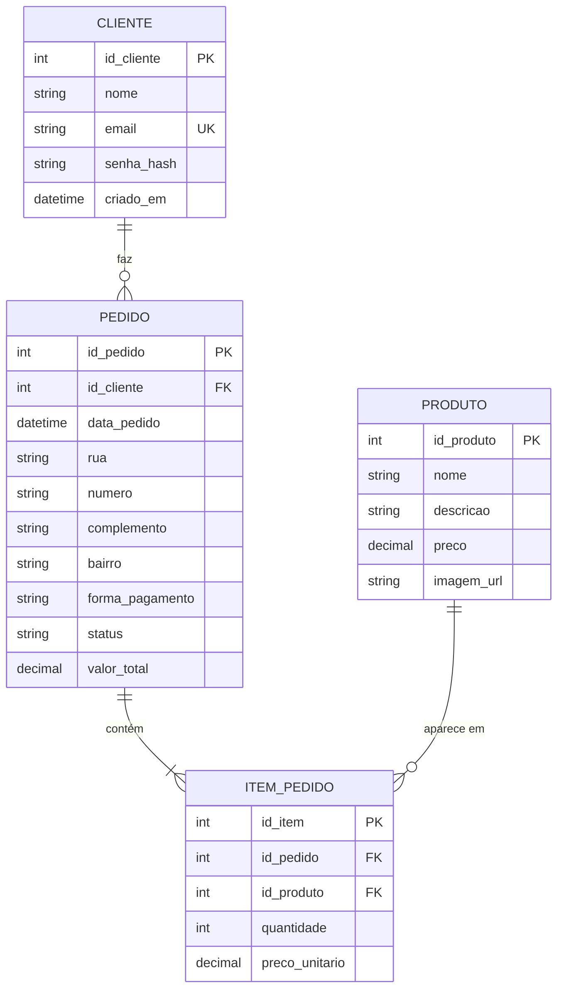

# 4. Projeto do Banco de Dados

O banco foi derivado do diagrama de classes de persistência ([02-modelagem-uml.md](02-modelagem-uml.md)) e passou pelas três etapas clássicas: projeto **conceitual**, projeto **lógico normalizado** e projeto **físico**.

**SGBD escolhido:** PostgreSQL (produção, no Render). Em desenvolvimento local é usado SQLite, sem mudar o código, graças ao ORM SQLAlchemy. O PostgreSQL foi escolhido por ser gratuito, muito usado no mercado e oferecido nativamente pelo Render.

| Tabela | Situação |
|---|---|
| `produtos` | ✅ Implementada |
| `clientes` | ✅ Implementada |
| `pedidos` | ✅ Implementada |
| `itens_pedido` | ✅ Implementada |

---

## 4.1 Projeto conceitual

Entidades e relacionamentos do negócio, independentes de tecnologia:

- Um **cliente** pode fazer **vários pedidos**; cada pedido pertence a **um único** cliente.
- Um **pedido** possui **um ou mais itens**; cada item pertence a **um único** pedido.
- Um **produto** pode aparecer em **vários itens** (de pedidos diferentes); cada item se refere a **um único** produto.

A relação **muitos-para-muitos** entre Pedido e Produto (um pedido tem vários produtos, e um produto está em vários pedidos) foi resolvida com a entidade associativa **ITEM_PEDIDO**, que também guarda dados próprios da relação: a quantidade e o preço.

## 4.2 Projeto lógico normalizado

Esquema relacional (`PK` = chave primária, `FK` = chave estrangeira):

- **clientes** (`id_cliente` PK, nome, email, senha_hash, criado_em)
- **produtos** (`id_produto` PK, nome, descricao, preco, imagem_url)
- **pedidos** (`id_pedido` PK, `id_cliente` FK → clientes, data_pedido, rua, numero, complemento, bairro, forma_pagamento, status, valor_total)
- **itens_pedido** (`id_item` PK, `id_pedido` FK → pedidos, `id_produto` FK → produtos, quantidade, preco_unitario)

### Verificação das formas normais

**1ª Forma Normal (1FN):** todos os atributos são atômicos. O endereço de entrega foi dividido em rua, número, complemento e bairro, em vez de um único texto. Os produtos de um pedido não ficam em uma lista dentro do pedido: cada um é uma linha em `itens_pedido`.

**2ª Forma Normal (2FN):** todas as tabelas têm chave primária simples (um único campo), então não existe dependência parcial de parte da chave.

**3ª Forma Normal (3FN):** nenhum atributo comum depende de outro atributo comum.
- O nome e o e-mail do cliente **não** são repetidos no pedido; o pedido guarda só `id_cliente`.
- O nome e a descrição do produto **não** são repetidos no item; o item guarda só `id_produto`.

### Decisões de projeto (redundâncias controladas)

Dois campos parecem redundantes, mas foram mantidos de propósito, porque representam um **fato histórico** do pedido:

| Campo | Por que existe |
|---|---|
| `itens_pedido.preco_unitario` | Guarda o preço **no momento da compra**. Se o preço do produto mudar amanhã, os pedidos antigos continuam com o valor correto (regra RN09). |
| `pedidos.valor_total` | Também é histórico, e evita recalcular a soma a cada consulta do histórico. É calculado pelo sistema a partir dos itens (RN10). |
| Endereço em `pedidos` | O endereço pertence à **entrega**, não ao cliente: o mesmo cliente pode pedir para lugares diferentes, e mudar o endereço depois não deve alterar pedidos antigos. |

## 4.3 Projeto físico

O script completo, válido para PostgreSQL, está em **[schema.sql](schema.sql)**. Restrições de integridade aplicadas:

| Tipo | Onde | Garante que... |
|---|---|---|
| Chave primária | Todas as tabelas | cada registro é único e identificável |
| Chave estrangeira | `pedidos.id_cliente` | todo pedido pertence a um cliente existente |
| Chave estrangeira (cascata) | `itens_pedido.id_pedido` | ao excluir um pedido, seus itens também são excluídos |
| Chave estrangeira | `itens_pedido.id_produto` | todo item se refere a um produto existente |
| Unicidade | `clientes.email` | não existem dois cadastros com o mesmo e-mail (RN01) |
| Unicidade | `itens_pedido (id_pedido, id_produto)` | o mesmo produto não aparece duas vezes no pedido; aumenta-se a quantidade |
| Checagem | `produtos.preco`, `itens_pedido.preco_unitario`, `pedidos.valor_total` | valores são maiores que zero |
| Checagem | `itens_pedido.quantidade` | a quantidade é maior que zero |
| Checagem | `pedidos.forma_pagamento` | só aceita `cartao`, `pix` ou `dinheiro` (RN08) |
| Checagem | `pedidos.status` | só aceita os estados previstos (RN11) |
| Índice | `pedidos.id_cliente`, `itens_pedido.id_pedido` | as consultas de histórico ficam rápidas |

## 4.4 Dicionário de dados

### Tabela `clientes` ✅
Pessoas cadastradas que podem fazer login e pedidos.

| Campo | Tipo | Nulo | Chave | Padrão | Domínio / regra | Descrição |
|---|---|---|---|---|---|---|
| id_cliente | SERIAL | Não | PK | automático | inteiro > 0 | Identificador do cliente |
| nome | VARCHAR(100) | Não | | | texto não vazio | Nome completo |
| email | VARCHAR(120) | Não | UK | | formato `nome@dominio.ext`, minúsculas (RN01, RN03) | E-mail usado no login |
| senha_hash | VARCHAR(255) | Não | | | hash gerado pelo Werkzeug (RN02) | Senha criptografada; a senha original nunca é guardada |
| criado_em | TIMESTAMP | Não | | data/hora atual | | Momento do cadastro |

### Tabela `produtos` ✅
Cupcakes exibidos na vitrine.

| Campo | Tipo | Nulo | Chave | Padrão | Domínio / regra | Descrição |
|---|---|---|---|---|---|---|
| id_produto | SERIAL | Não | PK | automático | inteiro > 0 | Identificador do produto |
| nome | VARCHAR(100) | Não | | | texto não vazio | Nome do cupcake |
| descricao | VARCHAR(255) | Sim | | | | Descrição curta exibida na vitrine |
| preco | NUMERIC(10,2) | Não | | | > 0, em reais | Preço de venda atual |
| imagem_url | VARCHAR(255) | Sim | | | caminho em `/static/imagens/` | Foto do produto |

### Tabela `pedidos` ✅
Cabeçalho do pedido: quem comprou, onde entregar e como pagar.

| Campo | Tipo | Nulo | Chave | Padrão | Domínio / regra | Descrição |
|---|---|---|---|---|---|---|
| id_pedido | SERIAL | Não | PK | automático | inteiro > 0 | Número do pedido |
| id_cliente | INTEGER | Não | FK | | cliente existente (RN05) | Cliente que fez o pedido |
| data_pedido | TIMESTAMP | Não | | data/hora atual | | Momento da compra |
| rua | VARCHAR(150) | Não | | | texto não vazio (RN07) | Rua ou avenida de entrega |
| numero | VARCHAR(10) | Não | | | texto não vazio (RN07); aceita "S/N" | Número do endereço |
| complemento | VARCHAR(60) | Sim | | | | Apartamento, bloco etc. |
| bairro | VARCHAR(80) | Não | | | texto não vazio (RN07) | Bairro de entrega |
| forma_pagamento | VARCHAR(10) | Não | | | `cartao`, `pix`, `dinheiro` (RN08) | Pagamento na entrega |
| status | VARCHAR(20) | Não | | `recebido` | `recebido`, `em_preparo`, `saiu_entrega`, `entregue`, `cancelado` (RN11) | Situação atual do pedido |
| valor_total | NUMERIC(10,2) | Não | | | > 0; soma dos itens (RN10) | Valor total do pedido |

### Tabela `itens_pedido` ✅
Cada cupcake de um pedido.

| Campo | Tipo | Nulo | Chave | Padrão | Domínio / regra | Descrição |
|---|---|---|---|---|---|---|
| id_item | SERIAL | Não | PK | automático | inteiro > 0 | Identificador do item |
| id_pedido | INTEGER | Não | FK | | pedido existente | Pedido ao qual o item pertence |
| id_produto | INTEGER | Não | FK | | produto existente | Cupcake comprado |
| quantidade | INTEGER | Não | | | > 0 | Quantidade comprada |
| preco_unitario | NUMERIC(10,2) | Não | | | > 0; preço do produto no momento da compra (RN09) | Valor de cada unidade |

> A coluna **Domínio / regra** mostra que o domínio de um atributo vai além do tipo de dado: `forma_pagamento` é um VARCHAR, mas só três valores são válidos.
